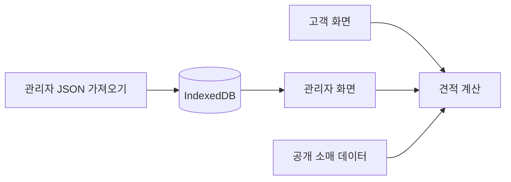

# 도배·장판 견적관리 🧾

어머니께서 도배·장판 시공 견적을 직접 계산하시는 걸 보고 만들기 시작한 프로그램입니다.

아파트인지 빌라인지, 몇 평인지, 어떤 벽지를 쓰는지에 따라 계산이 달라집니다. 짐 이동이나 작업 조건까지 더해지면 수기로 견적을 내는 데 시간이 꽤 걸려서, 자주 쓰는 기준을 등록하고 필요한 값만 선택해 견적을 계산할 수 있도록 구성했습니다.

현재는 React로 만든 정적 웹 앱이며, 별도 서버 없이 GitHub Pages 배포를 염두에 두고 있습니다.

## 주요 화면

- **고객 견적 (`/`):** 주거 유형과 시공 조건을 선택해 견적을 확인하는 화면
- **벽지 카탈로그:** 견적 화면에서 벽지 정보를 팝업으로 확인
- **관리자 (`/admin`):** 벽지·부자재·장판·공임 등의 데이터 수정, 견적 이력 확인 및 JSON 백업

관리자 페이지는 로그인 방식이 아닙니다. URL로 들어갈 수 있고 편집한 자료는 해당 브라우저의 IndexedDB에 저장됩니다. 따라서 여러 기기에서 데이터가 자동 공유되지는 않습니다.

## 만들면서 고민했던 부분

### 계산식을 화면 코드에 넣지 않기

견적 계산은 벽지 종류나 평형별 기준이 바뀌면 수정할 일이 많습니다. 그래서 화면과 계산 로직을 분리했습니다.

- [quoteEngine.ts](app/src/quoteEngine.ts): 견적 계산
- [quoteEngine.test.ts](app/src/quoteEngine.test.ts): 계산 로직 테스트
- [businessHours.ts](app/src/businessHours.ts): 영업시간 관련 로직

가격이나 산식이 확정되지 않은 항목은 임의의 금액으로 채우지 않았습니다. 실제 시공 기준을 확인하면서 보완할 예정입니다.

### 공개 가격과 내부 원가 구분하기

고객에게 보여주는 기본 소매 데이터와 실제 원가 데이터를 구분했습니다.

공개 데이터는 앱에 포함하지만, 원가 데이터는 관리자가 JSON을 직접 가져왔을 때 해당 브라우저의 IndexedDB에 저장하도록 했습니다. 저장소에는 실제 원가 자료나 고객 정보를 올리지 않는 방향으로 관리합니다.

다만 **브라우저에 저장한다는 것이 암호화나 관리자 인증을 의미하지는 않습니다.** 공용 기기에서 사용하거나 브라우저 데이터를 지우면 문제가 생길 수 있어 백업과 접근 방식은 더 보완해야 합니다.

### 서버 없이 배포하기

고객 견적과 관리자 편집을 우선 구현하기 위해 별도의 백엔드 서버는 두지 않았습니다.

GitHub Actions에서는 의존성을 설치한 뒤 테스트를 실행하고, 빌드에 성공하면 GitHub Pages 배포를 진행하도록 구성했습니다.



## 사용 기술

| 구분 | 기술 |
| --- | --- |
| Frontend | React 19, TypeScript 5, Vite 7 |
| 테스트 | Vitest, React Testing Library |
| 저장 방식 | IndexedDB, JSON |
| 배포 | GitHub Actions, GitHub Pages |

## 로컬 실행

Node.js와 npm이 필요합니다. GitHub Actions에서는 Node.js 24를 사용합니다.

```bash
cd app
npm ci
npm run dev
```

테스트와 빌드:

```bash
npm run test
npm run build
npm run preview
```

프로젝트 구조는 다음과 같습니다.

```text
app/
├── src/
│   ├── App.tsx
│   ├── quoteEngine.ts
│   ├── quoteEngine.test.ts
│   ├── businessHours.ts
│   ├── businessHours.test.ts
│   ├── storage.ts
│   └── data/
└── public/

.github/workflows/pages.yml
```

## 현재 남은 부분

- 일부 장판 단가, 노무 기준, VAT·짐 이동 비용 등 미확정 계산 기준 정리
- 견적 계산의 예외·경계값 테스트 보강
- 실제 사용 환경에서 백업과 고객 정보 관리 방식 검토
- 화면 캡처와 대표 견적 계산 예시 추가

**배포 경로 확인:** 현재 [워크플로](.github/workflows/pages.yml)는 `VITE_BASE_PATH=/`로 빌드합니다. 기본 GitHub Pages 프로젝트 주소(`/Wallpaper_Estimate/`)를 사용한다면 자산 경로가 맞는지 확인해야 합니다. 이 README 수정과 별개로 배포 설정은 변경하지 않았습니다.

---

[GitHub 프로필](https://github.com/Leeeyounghwan)
