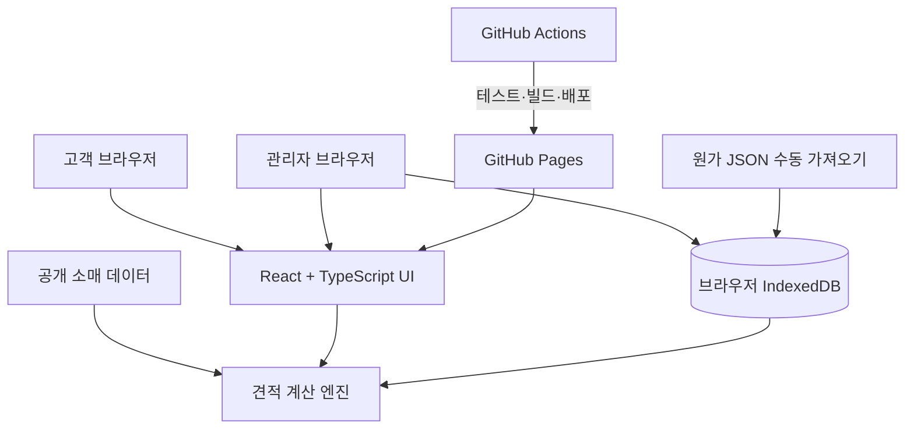

# 🧾 Wallpaper Estimate — 도배·장판 견적관리

**수기로 계산하던 도배·장판 시공 견적을 데이터 기반으로 정리하기 위한 웹 애플리케이션**

    

## 1. 문제 정의

아파트·빌라 유형, 평형, 벽지 종류, 작업 조건에 따라 견적을 수기로 계산하면 작업 시간이 길어지고 기준이 일관되지 않을 수 있습니다. 이를 줄이기 위해 **고객이 조건을 입력하는 견적 화면**과 **관리자가 단가 및 자료를 관리하는 화면**을 구성했습니다.

**설계 목표**
- 견적 계산 규칙을 UI에서 분리해 수정과 테스트가 가능하게 만들기
- 공개 가능한 소매 정보와 내부 원가 데이터를 구분하기
- 별도 서버 없이 브라우저에서 견적 자료와 임시 기록을 다루기
- 미확정 산식이나 단가는 임의 계산하지 않고 제한 사항으로 표시하기

## 2. 주요 기능

| 기능 | 설명 |
| --- | --- |
| 고객 견적 | 시공 조건 입력을 통한 견적 계산 화면 |
| 벽지 카탈로그 | 벽지 카드에서 카탈로그 팝업 표시 |
| 관리자 화면 | 벽지·부자재·장판·공임·카탈로그 정보 편집 |
| 견적 기록 | 문의일자, 고객 연락처, 견적 요약 및 상세 확인 |
| 백업 | JSON 내보내기·가져오기 |
| 로컬 보관 | 브라우저 IndexedDB에 관리자 자료 및 임시 기록 저장 |

**접근 경로:** 고객 화면 `/` · 관리자 화면 `/admin`

> `/admin`은 인증이 적용된 서버 관리자 페이지가 아닙니다. URL로 접근 가능한 클라이언트 화면이며, 데이터는 브라우저별로 분리됩니다. **URL을 알고 있는 것 자체가 접근 통제가 되지는 않습니다.**

## 3. 아키텍처



### Engineering Decisions

**① 견적 계산 로직 분리**

[quoteEngine.ts](app/src/quoteEngine.ts)에 견적 계산 로직을 두고, [quoteEngine.test.ts](app/src/quoteEngine.test.ts)로 규칙을 검증하도록 구성했습니다. 요구사항 변경이 잦은 견적 도메인에서 화면과 계산식의 결합을 줄이기 위한 구조입니다.

**② 공개 데이터와 원가의 경계**

공개용 소매 데이터는 저장소·배포 번들에 포함될 수 있습니다. 원가 자료는 관리자가 JSON을 수동으로 가져올 때 해당 브라우저의 IndexedDB에 보관하도록 설계했습니다.

**중요:** 브라우저 로컬 보관은 서버 기반 권한 관리나 데이터 암호화와 같지 않습니다. 공용 PC, 브라우저 데이터 삭제, 개발자 도구를 통한 열람 가능성 등을 고려해야 합니다.

**③ 정적 배포와 테스트**

백엔드 서버 없이 Vite 정적 빌드로 GitHub Pages에 배포하는 구조입니다. [.github/workflows/pages.yml](.github/workflows/pages.yml)은 의존성 설치 → Vitest 실행 → 빌드 → 업로드·배포 순으로 작성되어 있습니다.

## 4. 기술 구성

| 영역 | 기술 |
| --- | --- |
| Frontend | React 19, TypeScript 5, Vite 7 |
| Logic | TypeScript 기반 견적 엔진 |
| Storage | IndexedDB / JSON 가져오기·내보내기 |
| Test | Vitest, React Testing Library |
| CI/CD | GitHub Actions, GitHub Pages |

```text
Wallpaper_Estimate/
├── app/
│   ├── src/
│   │   ├── App.tsx
│   │   ├── quoteEngine.ts
│   │   ├── quoteEngine.test.ts
│   │   ├── businessHours.ts
│   │   ├── businessHours.test.ts
│   │   ├── storage.ts
│   │   └── data/
│   └── public/
├── .github/workflows/pages.yml
└── README.md
```

## 5. 로컬 실행과 테스트

**권장 환경:** Node.js 24 (GitHub Actions 설정 기준), npm

저장소 루트에서:
```bash
cd app
npm ci
npm run dev
```

별도 터미널 또는 중지 후 검증:
```bash
npm run test
npm run build
npm run preview
```

`npm run build`는 TypeScript 검사 후 Vite 빌드를 수행합니다. 자동 테스트는 실제로 실행된 환경과 결과를 확인해야 하며, 설정 파일 존재만으로 성공을 보장하지 않습니다.

## 6. 데이터 안전성과 운영 제약

- 관리자 자료, 견적 이력과 연락처는 **서버가 아닌 현재 브라우저**에 저장됩니다. 다른 기기와 자동 동기화되지 않습니다.
- 브라우저 저장소가 삭제되면 데이터가 소실될 수 있어 JSON 백업이 중요합니다.
- 공개 저장소에 실제 원가 JSON, 실제 고객 데이터나 내부 개발 자료를 올리지 않습니다.
- 고객에게 배포하는 기본 데이터는 `app/src/data/retail_rules.example.json`과 `app/public/retail_rules.example.json` 등을 기준으로 관리합니다.
- 일부 장판 단가·노무 기준·VAT 산식·짐 이동 비용 등은 **미확정 항목**으로, 임의 금액을 만들어 확정 견적처럼 제시하지 않습니다.

## 7. GitHub Pages 배포 확인 사항

워크플로는 `VITE_BASE_PATH=/`로 빌드하도록 작성되어 있습니다. 그러나 기본 프로젝트 Pages URL은 `https://leeeyounghwan.github.io/Wallpaper_Estimate/`처럼 저장소 하위 경로를 사용합니다.

**현재 설정과 기본 URL이 서로 다를 수 있으므로**, 실제 Pages 설정 및 사용자 정의 도메인을 확인해야 합니다. GitHub Pages 기본 프로젝트 경로로 배포한다면 `VITE_BASE_PATH=/Wallpaper_Estimate/`가 필요한지 검증하세요. README 변경만으로 워크플로를 수정하지는 않았습니다.

## 8. 다음 개선 과제

- 배포 경로와 자산 로딩 실제 검증
- 확정되지 않은 시공 단가·계산 규칙의 현업 확인
- 견적 엔진의 경계값·예외 입력 테스트 확장
- 브라우저 데이터 백업 및 고객 정보 보관 정책 정리
- 실제 화면 캡처 및 대표적인 견적 시나리오 문서화

---
[개발자 프로필](https://github.com/Leeeyounghwan) · [프로젝트 소스](https://github.com/Leeeyounghwan/Wallpaper_Estimate)
